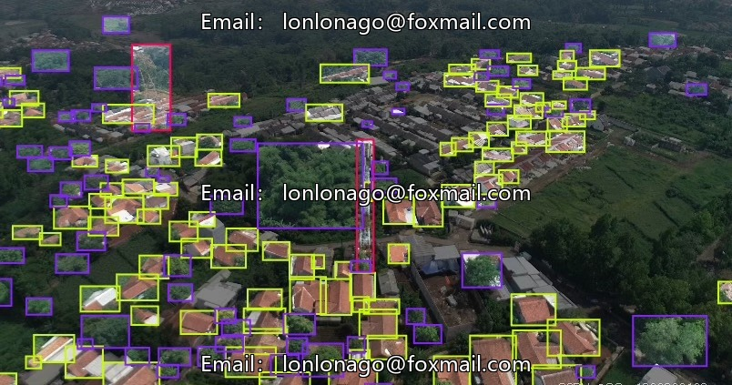
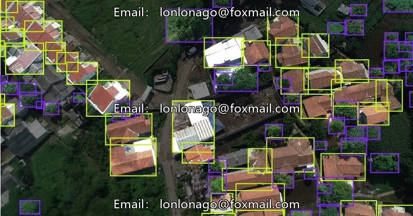
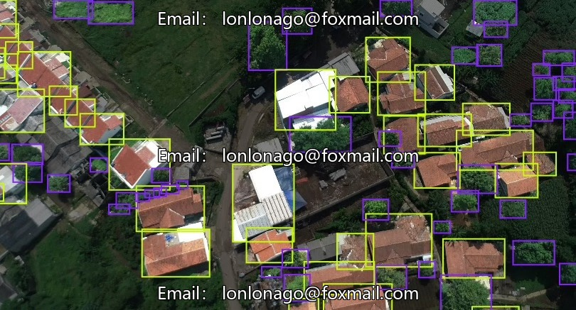
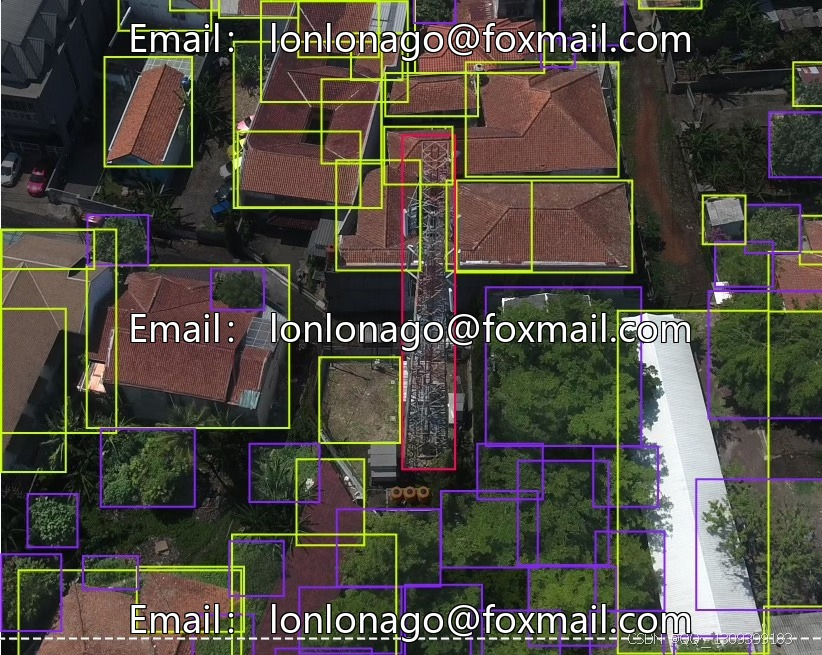
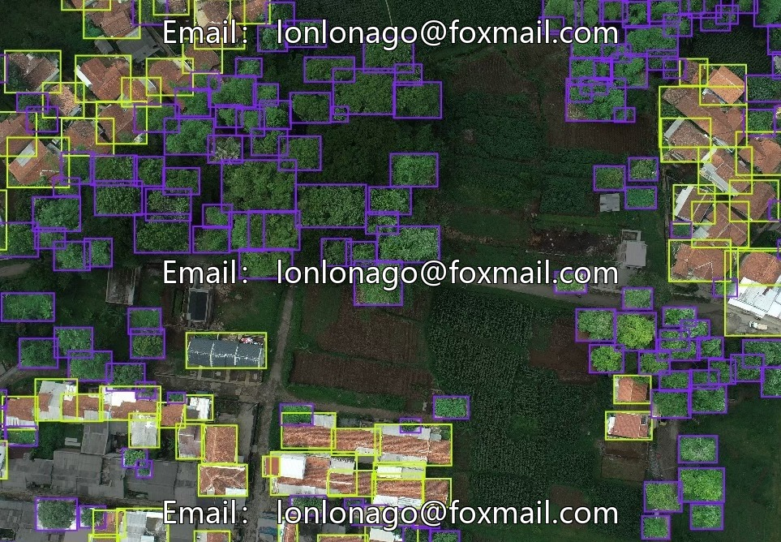

# Drone aerial photography dataset (10053 issue)

## Body

Drone aerial photography dataset (10053 issue) - Drone aerial inspection dataset, DJI drone aerial photography of houses, roofs, signal towers, trees with high resolution, issue 10053

Containing 1000 drone-view images, suitable for training computer vision object detection models. The data volume is moderate, with rich annotations. Each image has 183 annotations, covering three main categories: houses, towers, and trees. The label system is clear, and the training set has been divided, while the test set is not specified.

The data format is an image file + annotation file, supports mainstream computer vision training frameworks, can export multiple annotation formats, suitable for model development, algorithm verification, model debugging and other scenarios.

Virtual materials, once sold, are non-refundable.
Interested friends, click "I want" to proceed.

## Images

## Payment

Here is a pay link on Stripe ( https://buy.stripe.com/3cs8yP7sY87d0vu9AB ). Please contact me lonlonago@foxmail.com after funding $89, and I will send you a complete data files , thank you!

